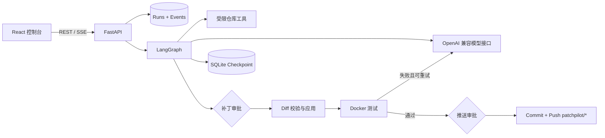

<div align="center">

# PatchPilot

**A human-approved code repair agent with auditable tools, isolated tests, and recoverable workflows.**

面向公开 Python 与 npm 仓库的代码修复 Agent：读取 Issue、分析代码、生成统一 Diff，经人工审批后在 Docker 中测试，并在最终确认后推送独立分支。

[](https://github.com/ongst/Patchpilot/actions/workflows/ci.yml)


</div>

## 项目简介

PatchPilot 探索的是一个很具体的问题：

> 在允许大模型修改代码之前，需要建立哪些工程边界，才能让它的行为可审阅、可暂停、可恢复、可验证？

它不是一个允许模型任意执行 Shell 的聊天壳，而是一条由确定性代码约束的修复流水线。模型负责搜索、理解和提出补丁；路径校验、补丁限制、审批、测试、状态持久化和 Git 写操作由应用本身控制。

```text
GitHub 仓库 + Issue
→ 克隆并创建隔离分支
→ 识别语言与基线测试
→ Agent 检索代码并生成 RepairPlan + Diff
→ 确定性补丁校验
→ 人工审批补丁
→ Docker 隔离测试
→ 失败后最多修复两轮
→ 人工审批推送
→ commit + push patchpilot/* 分支
```

## 为什么不只是“让模型生成代码”

| 普通单次提示 | PatchPilot |
| --- | --- |
| 一次性把大量代码交给模型 | 按需搜索、读取和记录已检查文件 |
| 模型输出后直接修改 | 统一 Diff 通过路径、规模与 `git apply --check` 校验 |
| 测试运行依赖本机环境 | Docker 中限制 CPU、内存、进程、时间与网络 |
| 高影响操作自动执行 | 应用补丁与推送分支前分别人工审批 |
| 中断后重新开始 | SQLite checkpoint 保存并恢复审批状态 |
| 只展示最终回答 | SSE 轨迹、结构化 Diff、测试结果与最终报告全程可审计 |

## 核心能力

- **受限代码检索**：文件树、符号摘要、全文搜索和按行读取，不向模型开放任意 Shell。
- **结构化决策**：模型输出 `RepairPlan` 与统一 Diff，工具参数使用严格 Schema。
- **确定性安全校验**：拒绝路径穿越、软链接逃逸、忽略目录、超大文件和超限补丁。
- **Human-in-the-loop**：应用补丁与远端推送拥有两个独立审批点，首次审批允许编辑原始 Diff。
- **隔离测试**：支持 Python 3.12 与 Node.js 22；正式测试禁网且不注入 API Key 或 GitHub Token。
- **失败修复循环**：根据测试输出最多重新规划两轮，超过限制后明确进入失败终态。
- **可恢复工作流**：LangGraph + SQLite checkpoint；重启后保留审批任务并清理失去线程的运行状态。
- **实时 Web 控制台**：React + TypeScript，SSE 支持续传，Diff 按文件展示增删行和逐行高亮。
- **协作式取消**：取消请求持久化后，在下一个安全边界停止，不把用户取消误报为系统失败。
- **最终运行报告**：汇总补丁、测试、尝试次数、Token、耗时和 Git 结果，并可导出 Markdown。

## 当前工程状态

| 项目 | 状态 |
| --- | --- |
| Python / npm 修复主流程 | 已实现 |
| 两阶段人工审批 | 已实现 |
| Docker 测试与失败重试 | 已实现 |
| SSE 实时轨迹与断线续传 | 已实现 |
| 结构化 Diff 审阅 | 已实现 |
| 取消、重启恢复与最终报告 | 已实现 |
| 确定性工作流端到端测试 | 已实现 |
| 12 项隐藏测试评测集定义 | 已实现 |
| 真实模型批量评测结果 | 待运行与发布 |
| 私有仓库与自动创建 PR | 暂不在首版范围 |

项目包含一个完全离线、无需真实模型和 GitHub Token 的黄金路径测试。它会真正应用补丁，并验证两次审批、测试结果、最终状态和运行报告是否一致。

## 架构



### 组件职责

```text
frontend/                 React 控制台、SSE、Diff 审阅和报告导出
backend/patchpilot/api.py HTTP 接口与错误语义
backend/patchpilot/service.py
                          后台任务、并发保护与取消分类
backend/patchpilot/workflow.py
                          LangGraph 状态图与两次审批
backend/patchpilot/repo_tools.py
                          受限搜索、读取与项目画像
backend/patchpilot/patching.py
                          Diff 解析、路径与规模校验
backend/patchpilot/test_runner.py
                          Docker 依赖安装与隔离测试
backend/patchpilot/git_service.py
                          分支、提交与安全推送
backend/patchpilot/db.py  Run、事件与状态持久化
evaluation/               12 项 Python / JavaScript 评测定义与评分脚本
eval/fixtures/            确定性端到端测试的固定缺陷仓库
```

## 安全边界

- 只接受 `https://github.com/{owner}/{repo}` 格式的公开仓库地址。
- 模型没有任意 Shell 工具；所有工具参数在本地再次验证。
- 工作区路径必须位于本次仓库中，拒绝绝对路径、`..`、逃逸软链接、依赖目录和二进制文件。
- 单次补丁默认不超过 8 个文件和 800 行。
- 测试命令只允许 pytest 或有限 npm scripts，不经过宿主机 Shell 拼接。
- 测试容器不含 LLM/GitHub 密钥，限制 CPU、内存、进程和时间；正式测试阶段禁用网络。
- Git 写操作仅允许 `patchpilot/run-*` 分支，永不 force push、合并或删除远端分支。
- 任务取消采用协作式模型：当前不可中断操作结束后，在下一个安全边界停止。
- API 和最终报告只暴露密钥是否配置，不返回任何真实凭据。

> **安全提示**
>
> Docker 能降低本地执行风险，但不是针对恶意仓库的绝对安全边界。当前版本只应运行用户自己拥有或明确可信的仓库，不应作为可执行任意第三方代码的公网服务部署。

## 快速开始

### 环境要求

- Windows 10 / 11
- Python 3.12+
- Node.js 22+
- Git
- Docker Desktop（需要启动 Docker Engine）

### 1. 克隆并安装

```powershell
git clone https://github.com/ongst/Patchpilot.git
cd Patchpilot
powershell -ExecutionPolicy Bypass -File scripts\setup.ps1
```

### 2. 配置环境变量

```powershell
Copy-Item .env.example .env
```

编辑 `.env`：

```dotenv
PATCHPILOT_LLM_API_KEY=your-deepseek-key
PATCHPILOT_LLM_BASE_URL=https://api.deepseek.com
PATCHPILOT_LLM_MODEL=deepseek-flash

# 只做本地修复时可以留空；推送远端分支时才需要。
PATCHPILOT_GITHUB_TOKEN=optional-fine-grained-token
```

GitHub Token 应使用 fine-grained token，并只为目标仓库授予 `Contents: Read and write`。

### 3. 启动

```powershell
powershell -ExecutionPolicy Bypass -File scripts\start.ps1
```

- Web 控制台：<http://127.0.0.1:5173>
- API 文档：<http://127.0.0.1:8000/docs>
- 健康检查：<http://127.0.0.1:8000/api/health>

页面左下角会分别显示数据库、Git、Docker、LLM，以及“修复就绪”和“推送就绪”状态。

## 开发与验证

运行完整检查：

```powershell
powershell -ExecutionPolicy Bypass -File scripts\check.ps1
```

它依次运行：

```text
Ruff
→ pytest + coverage
→ ESLint
→ TypeScript + Vite production build
```

### 确定性端到端测试

```powershell
.\.venv\Scripts\python.exe -m pytest backend/tests/test_workflow_e2e.py -v
```

测试使用 `eval/fixtures/python_calculator` 和 Fake LLM / Git / Runner 隔离不稳定外部依赖，同时保留真实 Git 初始化、真实补丁校验与应用、LangGraph checkpoint 和报告构建。

验证路径：

```text
基线失败
→ 生成确定补丁
→ 补丁审批通过
→ 文件真实改变
→ 修复后测试通过
→ 拒绝远端推送
→ completed_local
→ 最终报告与文件状态一致
```

### 评测集

仓库内定义了 6 个 Python 与 6 个原生 npm 缺陷任务，每项包含 Issue、可见仓库、隐藏测试与测试命令。

```powershell
python evaluation\materialize.py evaluation\generated
python evaluation\score.py results.json
```

当前仓库只声明评测协议和任务，不伪造尚未运行的真实模型成功率。正式结果会固定模型、Prompt、温度、工具轮次和重试次数后再发布。

## API

| 方法 | 路径 | 用途 |
| --- | --- | --- |
| `GET` | `/api/health` | 健康检查与修复/推送就绪状态 |
| `POST` | `/api/runs` | 创建修复任务 |
| `GET` | `/api/runs/{id}` | 获取当前状态 |
| `GET` | `/api/runs/{id}/events` | SSE 执行轨迹，支持断线续传 |
| `GET` | `/api/runs/{id}/diff` | 获取统一 Diff 与文件级统计 |
| `GET` | `/api/runs/{id}/report` | 获取终态运行报告 |
| `POST` | `/api/runs/{id}/decisions` | 批准、拒绝或编辑补丁 |
| `POST` | `/api/runs/{id}/cancel` | 协作式取消任务 |

## 状态与审批

关键状态流转：

```text
queued
→ cloning → profiling → baseline_testing
→ planning → validating_patch
→ awaiting_patch_approval
→ applying_patch → testing
→ repairing（最多两轮）或 awaiting_push_approval
→ committing → pushing
→ completed / completed_local / rejected / cancelled / failed
```

两个审批点都由 LangGraph `interrupt()` 暂停，并通过 SQLite checkpoint 恢复。服务重启后，审批等待任务仍可继续；失去后台线程的执行中任务会被明确标记为失败，而不是永久显示“运行中”。

## 当前限制

- 只支持公开 GitHub 仓库；私有仓库和自动创建 PR 暂不支持。
- JavaScript 项目需要使用 npm 并提交 `package-lock.json`。
- 依赖安装阶段需要网络；正式测试阶段禁网。
- 取消是协作式的，无法安全地立即杀死正在执行的 Python 线程或外部请求。
- 本地完整运行，不建议作为任意用户可访问的公网代码执行服务部署。

## 路线图

- [x] 可运行的代码修复 Agent MVP
- [x] LangGraph checkpoint 与双重人工审批
- [x] Docker 隔离测试与失败修复循环
- [x] SSE 续传、结构化 Diff、取消与异常恢复
- [x] 最终报告和确定性端到端集成测试
- [x] 12 项 Python / JavaScript 隐藏测试评测定义
- [ ] 运行并发布真实模型评测结果
- [ ] 使用两个公开固定缺陷仓库录制三分钟演示
- [ ] 完善移动端布局与运行历史筛选
- [ ] 可选的自动创建 Pull Request

## 项目材料

- [三分钟演示脚本](docs/demo-script.md)
- [简历描述](docs/resume.md)
- [评测协议](docs/evaluation.md)

## English summary

PatchPilot is a local-first code repair agent for public Python and npm repositories. It combines an OpenAI-compatible LLM with a deterministic LangGraph workflow, restricted repository tools, validated unified diffs, two human approval gates, Docker-isolated tests, SQLite checkpoints, resumable SSE traces, and exportable final reports. The project is designed as an auditable engineering system around the model rather than an unrestricted autonomous shell agent.
