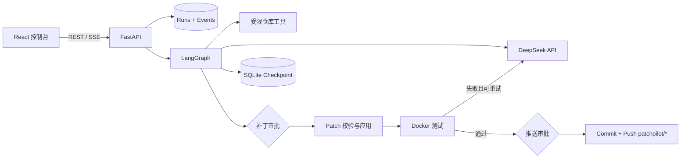

# PatchPilot

PatchPilot 是一个面向公开 Python 与 npm 仓库的代码修复 Agent。它读取 Issue，通过受限工具检查仓库，生成结构化修复计划与统一 Diff，在人工审批后于 Docker 中运行测试，最后再次审批并推送独立分支。

它的重点不是“让模型随意执行 Shell”，而是把模型判断放在可审计、可暂停、可恢复的工程边界中。

## 核心能力

- LangGraph 状态机与 SQLite checkpoint；
- 文件树、符号摘要、全文搜索和按行读取工具；
- 统一 Diff 的路径、文件数、行数与 `git apply --check` 校验；
- 补丁应用与远端推送的两次人工审批；
- Python 3.12 和 Node.js 22 Docker 测试器；
- 失败测试驱动的最多两轮增量修复；
- React Web 控制台、SSE 实时轨迹和结构化 Diff 审阅（按文件展示与增删行统计，审批前可编辑原始补丁）；
- 12 个带隐藏测试的评测任务。

## 架构



## 安全边界

- 只接受 `https://github.com/{owner}/{repo}` 格式的公开仓库地址。
- 模型没有任意 Shell 工具；工具参数在本地再次验证。
- 工作区路径必须位于本次仓库中，拒绝绝对路径、`..`、逃逸软链接、依赖目录和二进制文件。
- 单次补丁默认不超过 8 个文件和 800 行。
- 测试命令只允许 pytest 或有限 npm scripts，不经过宿主机 Shell 拼接。
- 测试容器不含 LLM/GitHub 密钥，限制 CPU、内存、进程和时间；正式测试禁用网络。
- Git 写操作仅允许 `patchpilot/run-*` 分支，永不 force push、合并或删除远端分支。

> Docker 能降低本地执行风险，但不是针对恶意仓库的绝对安全边界。首版只运行用户自己拥有或明确信任的仓库。

## 本地启动

需要 Python 3.12+、Node.js 22+、Git 和已启动的 Docker Desktop。

```powershell
cd D:\秋招+考研\patchpilot
powershell -ExecutionPolicy Bypass -File scripts\setup.ps1
```

编辑 `.env`：

```dotenv
PATCHPILOT_LLM_API_KEY=your-key
PATCHPILOT_LLM_BASE_URL=https://api.deepseek.com
PATCHPILOT_LLM_MODEL=deepseek-flash
PATCHPILOT_GITHUB_TOKEN=optional-fine-grained-token
```

启动：

```powershell
powershell -ExecutionPolicy Bypass -File scripts\start.ps1
```

- Web：http://127.0.0.1:5173
- API 文档：http://127.0.0.1:8000/docs
- 健康检查：http://127.0.0.1:8000/api/health

## 开发检查

```powershell
powershell -ExecutionPolicy Bypass -File scripts\check.ps1
```

该命令依次运行 Ruff、pytest、前端 ESLint 和生产构建。

## API

| 方法 | 路径 | 用途 |
|---|---|---|
| `GET` | `/api/health` | 健康检查 |
| `POST` | `/api/runs` | 创建修复任务 |
| `GET` | `/api/runs/{id}` | 获取当前状态 |
| `GET` | `/api/runs/{id}/events` | SSE 执行轨迹 |
| `GET` | `/api/runs/{id}/diff` | 获取统一 Diff |
| `POST` | `/api/runs/{id}/decisions` | 批准、拒绝或编辑补丁 |
| `POST` | `/api/runs/{id}/cancel` | 取消任务 |

### 健康检查

`GET /api/health` 返回运行环境就绪情况，不涉及业务数据：

| 字段 | 含义 |
|---|---|
| `status` | `ok` 表示就绪，`degraded` 表示有依赖缺失 |
| `database` / `git` / `docker` / `llm_configured` | 四项底层依赖各自的检查结果 |
| `ready_for_repair` | 本地修复条件是否满足（四项底层依赖全部就绪） |
| `ready_for_push` | 修复条件和 GitHub 推送凭据是否同时满足 |

接口只返回凭据是否存在（体现在 `ready_for_push` 布尔值中），不会向前端返回任何真实密钥。

### SSE 执行轨迹

`GET /api/runs/{id}/events` 使用 SSE 实时推送执行轨迹：

- 支持 `after` 查询参数和 `Last-Event-ID` 请求头两种续传游标，断线重连后只返回尚未接收的事件；
- 任务进入终态后会发送 `end` 事件并自动关闭连接。

## 当前限制

- 只支持公开 GitHub 仓库；私有仓库和自动 PR 不在首版范围。
- JavaScript 项目必须使用 npm 并提交 `package-lock.json`。
- 推送要求 fine-grained GitHub Token 对目标仓库具有 Contents write 权限。
- 依赖安装阶段需要网络；正式测试阶段禁网。

## 项目材料

- [三分钟演示脚本](docs/demo-script.md)
- [简历素材](docs/resume.md)
- [评测协议](docs/evaluation.md)
